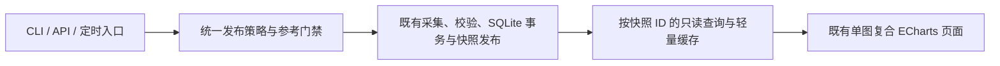

# 架构与代码审计

## 实际结构与入口

顶层为 `server.py`、`scripts/`、`web/`、`data/`、`tests/`、`.github/workflows/`、`docs/`。`server.py:42-59` 创建 FastAPI，挂载静态 HTML/JS，装配资金流、分红、五年之锚、股债性价比路由。`server.py:160-286` 管理后台更新；`server.py:466-523` 公开快照与轮动总览。启动命令是 `python -m uvicorn server:app --host 127.0.0.1 --port 8000`（README）。无 React/Vue；前端为原生 JS + 本地 ECharts 5.5.1。依赖见 `requirements.txt`：FastAPI、Uvicorn、AkShare、keyring、pypdf 等；ETFirst 另行安装。定时路径为 `.github/workflows/daily-update.yml` 与 `scripts/run_daily_verified.ps1`，本地 API 后台任务由 FastAPI `BackgroundTasks` 启动。

### 三条端到端链路

| 链路 | 真实模块与流向 | 评价 |
|---|---|---|
| A 指数→轮动 | `fetch_data.py` → `update_data.py:555-671` → `index_verification.py:698` 门禁 → `storage.py:477` 提交/发布 → `prism_metrics.py:22-135` 日期对齐与指标 → `/api/snapshot/data/index_prices.json` → `web/app.js:218-250` | 缺日不补值、版本化发布；CLI 默认门禁关闭为主要断点；整包加载有成本。 |
| B 份额→资金流 | `fund_flow/providers/{sse,szse,csv,...}` → `services/sync.py` → `corporate_actions.py:60` 复权 → `persistence.py:57-114` 物化 → `flows.py:21-110` → `fund_flow/api.py:89-158` → `web/fund-flow.js` | 单位与缺失状态明确；资金流是“份额差×净值”的估算，不等同现金流；需保持页面说明。 |
| C 分红→股息率 | `dividend/providers.py`/官方公告 → `dividend/db.py` 来源与版本 → `service.py:199-258` 逐日覆盖 → `domain.py:82-98` TTM → `dividend/api.py:97-103` → `web/dividend.js` | 不完整覆盖返回空值；历史逐日查询有可测的重复读风险。 |

## 边界与维护性

采集/计算/呈现已经按业务域拆分，增指标无需全面重构。`scripts/update_data.py:403-840` 单个更新过程同时承担来源选择、日历、证据、策略计算及发布；新增指数源容易触碰核心路径。`web/app.js` 约 59 KB，把基准日期、金融计算、ECharts 配置、交互与更新任务放在一处（例如 `web/app.js:35-102,218-250`）；可以按“数据加载/纯计算/图表配置”渐进拆分，保留当前 HTML 与图表组合。`server.py:493-506` 每次总览重读并重算，适合按快照 ID 缓存。数据库以 `scripts/storage.py` 为主，但资金流、分红各有独立连接模块，属可接受的域边界；先统一连接约定与只读查询性能记录，不建议引入 ORM。

## 建议目标结构

核心改动是让所有入口走同一个默认安全策略，并让查询层提供有界数据；不改变策略公式或数据库选型。配置已通过 `scripts/config.py:1-9` 的 `ETF_DATA_DIR` 集中数据目录，但来源选取仍分散在 `fetch_data.py`、`update_data.py` 及业务 providers，应把映射与状态写入可核验记录，避免再用运行环境隐含决定来源。`CONTEXT.md` 属上层个人理财上下文，ETF 项目没有单独 ADR；本报告沿用代码中 ETF/指数术语，未把个人资产估值术语强加于市场数据。
