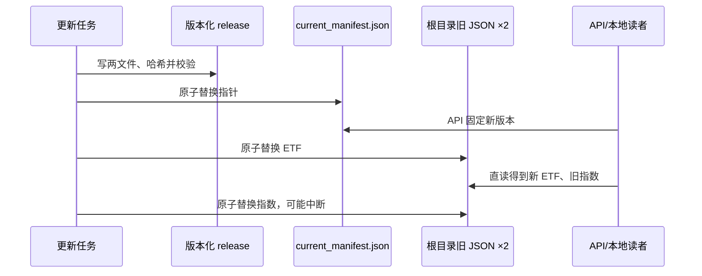
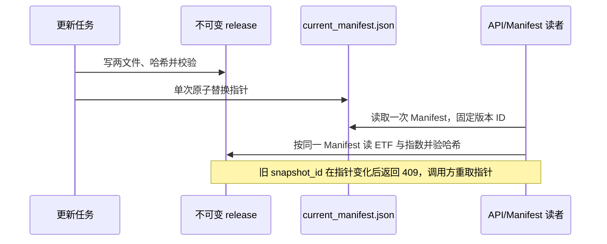

# A08 快照版本一致性整改

日期：2026-11-18。范围仅为发布指针、受支持的快照读取与本地回滚。项目工作区在本轮开始前已有未提交变更；本轮未改金融公式、指数放行、数据库结构、历史行情或 A03 投影规则。

## 根因与复现

`scripts/storage.py` 原先先完整写入并校验 `releases/<id>/etf_prices.json` 和 `index_prices.json`，然后原子替换 `current_manifest.json`；**指针切换后**又依次替换根目录的两个同名 JSON。后两次 `os.replace` 各自原子，但两文件集合不是原子快照。在临时目录对第二次镜像替换注入 `OSError`，实测得到 `Manifest=new、根 ETF=new、根指数=old`。主 FastAPI 行情 API 已从 Manifest 读取，因此主要风险在仍把根目录文件当作当前版本的本地/外部脚本；此前 `windows_local_release.py` 的备份清单和 `index_verification_integrity.py` 仍读取根文件。

### 改造前



### 改造后



## 方案与修改文件

- `scripts/storage.py`：`activate_snapshot` 只验证两份版本文件并切换一个 Manifest；不再更新根目录镜像。发布中断前，旧指针有效；切换成功后，没有第二个可能失败的镜像替换步骤。`recover_prepared_release` 仍依数据库 prepared 标记和文件/哈希检查恢复，历史 release 保留。
- `scripts/snapshot.py`：保留原有 `read_manifest` 一次固定指针、`read_dataset` 按同一 Manifest 校验文件哈希与版本的机制；未改动该模块。
- `server.py`（本轮未改）：旧 `/api/snapshot/data/{dataset_name}` 和 A03 `/api/snapshot/index-view` 保留原有协议：未带 ID 读取当前版本，`snapshot_id` 与当前指针不同则返回 409。前端可重取 `/api/snapshot`；单次请求不会跨两份 Manifest。未开放 staged release 的直接读取。
- `scripts/windows_local_release.py`：新备份仅封存 SQLite、当前 Manifest 和它引用的两份版本文件；旧备份清单若含根目录镜像，回滚仍可读取并恢复。
- `scripts/index_verification_integrity.py`：当前指数文件摘要改为取 Manifest 引用的文件。旧基线若记录的是根文件路径，则比较状态为 `PATH_SET_CHANGED`、布尔结果为 `null`，不伪称同一对象可比。
- `README.md`：明确当前版本读取契约。新增 `tests/test_snapshot_consistency_a08.py`，扩展 `tests/test_windows_local_release.py`。

根目录旧 `data/etf_prices.json`、`data/index_prices.json` **保留原有字节作为历史兼容文件，不再自动更新，也不是受支持的当前版本入口**。原有 API URL 不变且仍获取当前版本；需要文件读取的调用方应先读取一次 Manifest，再用其中两条版本化路径。`read_manifest` 对没有 Manifest 的旧安装仍保留 legacy 回退。无法在两个独立根文件路径上实现集合原子性，因此没有把两次 `os.replace` 伪装成兼容的当前版本协议。

## 验证结果

隔离目录测试覆盖：正常准备/发布、候选版本发布前 API 返回 409、指针替换故障、旧指针保持、恢复 prepared release、新旧版本切换、并发中固定旧 Manifest 后读两文件、旧全量 API 与 A03 API 的当前版本读取及旧 ID 返回 409、根旧文件不再变化、旧格式 Windows 备份回滚。A04 原有测试验证同版本只计算一次、新版本失效、文件损坏返回 503；缓存键包括数据根目录、快照 ID、两文件路径和实时 SHA256。指针切换发生在总览计算中时返回 503，不返回跨版本聚合；客户端可重试。

命令及结果：

```powershell
$env:PYTHONDONTWRITEBYTECODE='1'
$env:PYTEST_DISABLE_PLUGIN_AUTOLOAD='1'
python -B -m pytest -q -p no:cacheprovider
# 507 passed, 24 skipped, 2 个本机可选 pandas 依赖警告
python -B tests/bench_a03_a04.py
```

最终完整回归在所有 A08 代码和测试调整后执行；结果见下文。

## A03/A04 性能影响

相同快照、同一 TestClient 隔离副本、每接口 12 次；P95 是小样本最近秩。两轮期间机器负载变化明显，不能将耗时差全部归因于 A08。响应体积未变，SQLite 查询均为零。

| 场景 | A08 前 P50/P95 | A08 后 P50/P95 | 体积 |
|---|---:|---:|---:|
| 旧全量指数 API | 1349.96/1535.91 ms | 769.02/833.29 ms | 18,768,125 B |
| A03 三棱镜投影 | 585.52/718.43 ms | 461.28/592.90 ms | 1,161,965 B |
| A03 配置策略投影 | 450.19/504.77 ms | 437.43/524.61 ms | 2,027,929 B |
| A04 总览热请求 | P50 62.25 ms | P50 33.86 ms | 8,837 B |
| A04 换版本首次访问 | 876.00 ms | 891.24 ms | 8,837 B |

A08 未改变这三个行情读取入口；快照内容与金融结果未改变。原总览缓存仍逐次哈希文件，以防损坏或旧版本污染。表中没有可归因于 A08 的性能回退证据；需在稳定负载下重复基准才能定量判断毫秒级成本。

## 回滚与残留风险

代码回滚可恢复原 `activate_snapshot` 镜像步骤及原 API 409 行为；不需数据库迁移，已保留的 release 和 Manifest 可继续读取。若要恢复某个历史业务版本，应在停机状态使用 `windows_local_release.py rollback` 的封存备份，或经现有 prepared release 恢复流程；不要直接手工拼接两个根文件。

残留风险：项目外部若仍直读根目录两个旧 JSON，将看到**冻结的旧版本**，需要迁至 Manifest 或 API；历史文档中对此路径的描述也可能是旧口径。保留的历史 release 可供现有回滚流程使用，API 按既有契约只读当前版本，切换后的旧 ID 返回 409。数据库诊断页与行情快照是不同存储视图，更新事务提交与 Manifest 切换之间的极短窗口可能显示待发布诊断状态；本轮只保证**ETF/指数发布快照集合**的读取一致性。测试未覆盖断电级文件系统持久化、跨机器共享盘、外部脚本的未知读法或真实在线更新；这些不能由本机故障注入直接证明。
