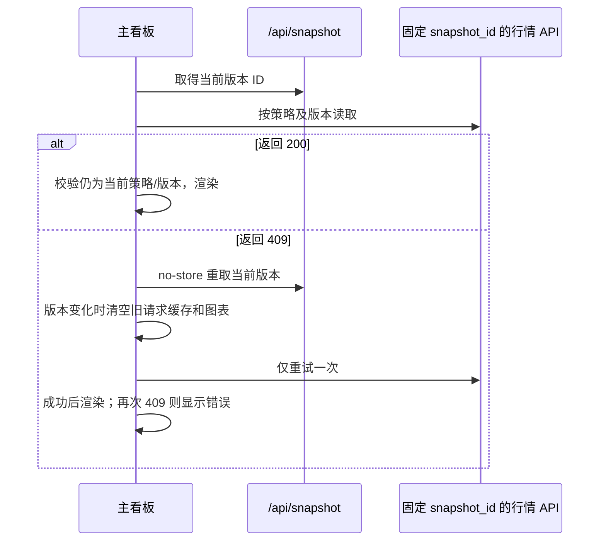

# A07 前端结构审查

## 当前结构

前端是原生 JavaScript、ECharts 和多 HTML 页面；`navigation.js`、`chart-theme.js`、`theme.css` 与 `ui-components.css` 已提供部分共享边界。`web/app.js` 约 59 KB，单文件包含 Manifest/行情请求、收益计算、策略切换、图表配置、表格、CSV、策略说明和数据更新任务。`anchor.js`、`fund-flow.js` 各自维护页面级状态和请求。未发现需要引入复杂框架的证据。

## 逐项结论

| 审查项 | 证据 | 处理 |
|---|---|---|
| 大文件与职责耦合 | `app.js` 的 `ensureDashboardData`、`buildSeries`、`renderETF`、三棱镜渲染、`refreshData` 同处一文件，且后部有运行时函数包装。 | 本轮只将 409 恢复收敛为 `reloadSnapshotManifest`、`recoverSnapshotConflict` 与有界重试路径；纯计算和图表配置暂不大规模搬移。 |
| 相同数据重复请求 | `indexDatasetLoad` 用 `snapshot_id:strategy` 保存 Promise，ETF 请求也有同版本 Promise；基准日期/结束日期变动在本地重算。 | 保留 A03 现有缓存，不重复建设。浏览器实测主 ETF 页只取 ETF 620,166 B 和 `etf-index` 投影 307,961 B；三棱镜 1,161,965 B，无全量指数 18.8 MB 请求。 |
| 全局状态 | `activeSnapshotId`、`dataset`、`indexDataset`、`window.activeDashboard` 与 ECharts 实例是页级可变状态。 | 本轮在版本切换时同时清掉旧快照缓存、已显示图表与 KPI，避免继续呈现旧版本；独立状态容器待未来基于固定样本逐步提取。 |
| 请求竞态 | 主指数图已有 `indexChartRequest`、快照 ID 和筛选值检查；策略切换后只为当前策略调用 `render`。`anchor.js`、`fund-flow.js` 的 `load` 没有同类请求序号，快速改变控件时旧响应有覆盖风险（静态推断，未完成故障注入）。 | 主页面继续用现有守卫；其他页面列待验证清单，不在本轮改动。 |
| 事件与资源 | 主页面 `prismInteraction.bound` 防止重复绑定，策略按钮使用 `.onclick`，不因切换重复添加；页面导航会卸载旧 document。`ResizeObserver` 在页面寿命内保持连接。 | 暂无已证实泄漏；保留现状。 |
| 图表配置复用 | `chart-theme.js` 已共享颜色、单位格式、Tooltip 和基本轴。ETF 与指数复合图需共用单位说明。 | 新增局部 `compositeChartBase`，只为两个现有复合图设置 `% / pp` 轴名，不改变计算与单图结构。 |
| 样式与控件 | 多数页面复用 `theme.css`/`ui-components.css`，但部分页面仍有自身 CSS/脚本及不同图表标题细节。 | 本轮只对复合图补单位文字和无障碍标签；不统一整站布局。 |

## 当前版本读取流程

## 后续可做但本轮不实施

1. 用固定行情样本验证 `anchor.js`/`fund-flow.js` 快速连续筛选的竞态，再决定是否加请求序号或取消请求。
2. 给 `app.js` 的纯金融显示计算和图表配置建立可直接调用的测试边界，再按一类图表一次迁出。避免一次性改动策略、日期和缩放联动。
3. 若 Performance trace 证明主线程构表或 ECharts 重绘占据显著耗时，再考虑隐藏表格按需生成；当前没有足够证据直接改动。

这些建议不涉及金融指标公式、指数放行、A03/A04/A08 后端或投资策略逻辑。
